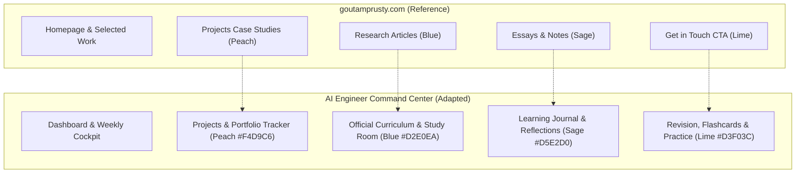
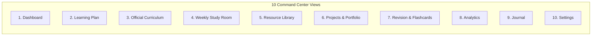

# Paper & Signal Design System Alignment & Implementation Blueprint
**Project:** AI Engineer Command Center  
**Repository:** `goutam-prusty/ai-engineer-command-center`  
**Reference Design System:** `WEBSITE_THEME_AND_UI_UX_DESIGN_SYSTEM.md`  
**Reference Codebase:** `goutam-prusty/goutamprusty-v2` (`commit 97f3a16`, branch `codex/paper-signal-prototype`)  
**Audit Baseline:** `ui_ux_audit_report.md`  
**Document Status:** Complete Planning & Architecture Blueprint (Phase 0)  

---

## 1. Summary of the Paper & Signal Design Identity

The **Paper & Signal** visual identity is an understated, editorial, and thoughtful design language. It replaces generic SaaS-dashboard conventions (blue card gradients, floating glass panels, saturated status pills) with a calm, publication-grade atmosphere inspired by physical paper, editorial broadsheets, and selective precision accents.

### Core Philosophy & Tenets
1. **Calm, Credible, and Professional:** The design conveys quiet authority through classical typography hierarchies, controlled reading measures, and generous, purposeful whitespace.
2. **Warm Paper Foundation:** A unified warm paper background (`#F7F4EC`) anchors all screens, supported by crisp raised surface panels (`#FDFCF8`) and sunken data wells (`#EFEBDF`).
3. **Punctuation Accent ("Signal"):** A single vivid lime accent (`#D3F03C`) is used strictly as visual punctuation—primary action buttons, active indicator markers, and high-visibility keyboard focus rings—always paired with dark ink text. It is never used as wallpaper or passive card backgrounds.
4. **Content-Type Pastels:** Muted pastel tints—Peach (`#F4D9C6`), Blue (`#D2E0EA`), and Sage (`#D5E2D0`)—are used as surface background treatments for semantic grouping, never for text.
5. **Strictly Light-Only:** In accordance with confirmed design authority decisions, **dark mode, theme toggles, and dark hero banners are strictly prohibited**.
6. **Rectilinear & Restrained Geometry:** Zero bubbly pills or heavy rounded corners (`border-radius: 0` or subtle `2px` focus offsets). Borders are thin, visible hairline strokes (`#827D71`) that achieve over 3:1 contrast against warm paper and pastel surfaces.
7. **Zero Superfluous Motion:** No scroll-jacking, no parallax, no decorative entrance animations, and full respects for `prefers-reduced-motion`.

---

## 2. Exact Reference Values Extracted from the Original Code

All values below were extracted directly from `src/styles/paper-signal.css`, `src/styles/global.css`, `src/layouts/PaperSignalLayout.astro`, and prototype pages in `goutam-prusty/goutamprusty-v2` at commit `97f3a16`:

### A. Color Tokens
```css
--color-paper:      #f7f4ec;  /* Main page background */
--color-surface:    #fdfcf8;  /* Raised surface (cards, panels) */
--color-sunken:     #efebdf;  /* Recessed surface (tables, code, wells) */
--color-ink:        #17191a;  /* Primary text (high contrast dark ink) */
--color-secondary:  #4a4f4c;  /* Secondary text / captions / kickers */
--color-line:       #827d71;  /* Visible border (darkened for >= 3:1 contrast) */
--color-line-soft:  #ddd8cb;  /* Decorative divider (legacy / non-essential) */
--color-project:    #f4d9c6;  /* Peach pastel = Projects */
--color-research:   #d2e0ea;  /* Blue pastel  = Research / Syllabus */
--color-writing:    #d5e2d0;  /* Sage pastel  = Writing / Journal */
--color-signal:     #d3f03c;  /* Lime accent  = Signal / Primary Action */
```

### B. Typography Font Stacks (Operating System Native — Zero Downloads)
```css
--font-display: "Iowan Old Style", "Palatino Linotype", "Book Antiqua", Georgia, serif;
--font-body:    "Segoe UI", "Helvetica Neue", Arial, sans-serif;
--font-mono:    "Cascadia Code", Consolas, monospace;
```

### C. Typography Sizing, Weights & Measures
- **Base body font size:** `1rem` (16px), `line-height: 1.65`
- **Body text color:** `var(--color-ink)` (`#17191A`), long-form article text: `#272B29`
- **Heading styles (`h1`, `h2`, `h3`):** `font-family: var(--font-display)`, `font-weight: 500`, `line-height: 1.08`, `text-wrap: balance`
  - `h1`: `clamp(2.8rem, 7.4vw, 6.35rem)`, `letter-spacing: -.05em`, `max-width: 13ch` (display hero)
  - `h2`: `clamp(2rem, 4vw, 3.15rem)`, `letter-spacing: -.035em`
  - `h3`: `clamp(1.4rem, 2.6vw, 2rem)`
- **Eyebrow / Kicker:** `font: 700 .72rem/1.4 var(--font-mono); letter-spacing: .09em; text-transform: uppercase; color: var(--color-secondary);`
- **Metadata row:** `font: .76rem var(--font-mono); color: var(--color-secondary); gap: .45rem 1.5rem;`
- **Reading measure:** `--reading: 44rem;` (704px), max body measure: `68ch`
- **Container wide max-width:** `--wide: 76rem;` (1216px)

### D. Focus, Links & Tap Targets
- **Focus visible:** `outline: 3px solid var(--color-ink); outline-offset: 4px; box-shadow: 0 0 0 7px var(--color-signal);`
- **Link underline:** `text-decoration-thickness: .08em; text-underline-offset: .22em;` (hover: `.14em`)
- **Active navigation link:** `text-decoration: underline; text-decoration-color: var(--color-ink); text-decoration-thickness: 2px; text-underline-offset: .45rem;`
- **Minimum mobile touch target:** `min-height: 2.75rem;` (44px at 16px root)

### E. Borders, Elevation & Geometry
- **Card / panel border:** `1px solid var(--color-line)` (`#827D71`)
- **Note / Callout well:** `border-left: 4px solid var(--color-ink); background: var(--color-sunken); padding: 1rem 1.1rem;`
- **Border radius:** Strictly `0` (rectilinear) across cards, buttons, navbars, and inputs. `50%` used exclusively for geometric circle compositions.
- **Elevation / shadows:** Flat surfaces; no drop shadows. Only confirmed shadow is the lime focus ring.

### F. Tables & Code Blocks
- **Wrapper (`.ps-table-wrap`, `.ps-code-wrap`):** `border: 1px solid var(--color-line); background: var(--color-surface); max-width: 100%; overflow-x: auto; overscroll-behavior-inline: contain; -webkit-overflow-scrolling: touch;`
- **Table element:** `width: 100%; min-width: 34rem; border-collapse: collapse; font-size: .86rem;`
- **Table header (`th`):** `background: var(--color-sunken); font-weight: 700; padding: .7rem .8rem;`
- **Table cells (`td`):** `padding: .7rem .8rem; border-top: 1px solid var(--color-line);`
- **Code pre:** `font: .82rem/1.65 var(--font-mono); padding: 1rem;`

### G. Buttons & Controls
- **Primary Action (`.ps-button` / `.ps-contact-link`):** `padding: .65rem .9rem; background: var(--color-signal); border: 1px solid var(--color-ink); color: var(--color-ink); font-weight: 600; font-size: .9rem;`
- **Disabled state:** `cursor: not-allowed; opacity: 0.55;`

### H. Breakpoints
- Tablet / Desktop split: `52rem` (832px)
- Mobile navigation disclosure collapse: `34rem` (544px)

---

## 3. Values that Remain Unverified / NOT SPECIFIED in the Reference Code

The following application-specific components were not built in the reference portfolio prototype and are marked `NOT SPECIFIED`:

| UI Area | Unverified Value | Recommended Decision Requiring Approval |
| :--- | :--- | :--- |
| **Form Inputs & Selects** | Exact input padding, border focus color | Use `padding: 0.5rem 0.75rem; border: 1px solid #827D71; background: #FDFCF8; font-family: var(--font-body); font-size: 0.875rem;`. On `:focus-visible`, apply the standard lime focus ring. |
| **Progress & Mastery Statuses** | Distinct colors for the 6 learning topic states | **Map strictly into the 3 confirmed pastels + sunken** (see Section 5 below) so no arbitrary colors are introduced. |
| **Destructive Actions** | Negative/Delete state color (e.g. Reset All Progress) | **Muted terracotta/brick:** `#C84B31` text on `#F7DCD6` surface with `#827D71` border, or dark ink `#17191A` outline with alert iconography. Requires approval. |
| **Modal / Dialog Overlay** | Backdrop overlay color and opacity | Use `#17191A` at 35% opacity with `backdrop-filter: blur(0px)` (zero blur, preserving the clean paper aesthetic). |
| **Segmented Control Tabs** | Active pill vs background structure | Rectilinear segmented row: active tab filled with `#17191A` (ink) and `#FDFCF8` (paper surface) text, or `#D3F03C` (lime) with `#17191A` text. |

---

## 4. Mapping between Reference System and Command Center



The Command Center is an intensive learning system rather than an author's reading site. However, its ten functional views naturally align with the Paper & Signal semantic spectrum:
1. **Projects & Portfolio (`projects`)** $\rightarrow$ **Peach (`#F4D9C6`)**: Tint for capstone badges, milestone achievements, and architecture summaries.
2. **Curriculum & Study Room (`curriculum`, `study-room`, `resources`)** $\rightarrow$ **Blue (`#D2E0EA`)**: Tint for official DataMites syllabus blocks, theory modules, and resource tier headers.
3. **Learning Journal (`journal`)** $\rightarrow$ **Sage (`#D5E2D0`)**: Tint for study reflection entries, problem logs, and mentor discussion notes.
4. **Active Recall & Operations (`revision`, `plan`, `settings`, `dashboard`)** $\rightarrow$ **Signal Lime (`#D3F03C`)**: Accent for the active week indicator, flashcard score counter, "Continue Learning" trigger, and primary action buttons.

---

## 5. Proposed Semantic Color Mapping for the Learning Application

To prevent visual chaos and preserve the strict Paper & Signal identity, **we map all existing learning statuses directly into the confirmed pastel and neutral palette**, eliminating random blues, greens, yellows, and purples:

### A. Curriculum Topic Statuses (6 States)
| Topic Status | Proposed Background | Proposed Text | Proposed Border | Aesthetic Rationale |
| :--- | :--- | :--- | :--- | :--- |
| **Complete** | Sage Pastel (`#D5E2D0`) | Dark Ink (`#17191A`) | `#827D71` | Calm, verified completion (replaces neon green). |
| **Demonstrated** | Sage Pastel (`#D5E2D0`) | Dark Ink (`#17191A`) | `#17191A` (2px) | Verified hands-on proof; emphasized with dark hairline. |
| **Practised** | Blue Pastel (`#D2E0EA`) | Dark Ink (`#17191A`) | `#827D71` | Active hands-on learning (research/practice tier). |
| **In Progress** | Blue Pastel (`#D2E0EA`) | Dark Ink (`#17191A`) | `#827D71` (dashed) | Currently underway; subtle dashed border distinction. |
| **Needs Revision** | Peach Pastel (`#F4D9C6`) | Dark Ink (`#17191A`) | `#827D71` | Warm attention required (replaces bright amber). |
| **Not Started** | Sunken Neutral (`#EFEBDF`) | Secondary Ink (`#4A4F4C`) | `#DDD8CB` | Quiet, unstarted state recedes into background. |

*Contrast Verification:* All text is `#17191A` on pastel backgrounds, yielding **> 6.5:1 contrast** (exceeds WCAG 2.2 AAA standard).

### B. Spaced-Repetition Flashcard States
- **Known:** Sage Pastel (`#D5E2D0`) fill, `#17191A` text.
- **Needs Review:** Peach Pastel (`#F4D9C6`) fill, `#17191A` text.
- **Unreviewed:** Sunken (`#EFEBDF`) fill, `#4A4F4C` text.
- **Card Flip Action:** Signal Lime (`#D3F03C`) highlight on active card index.

### C. Resource Classification Tags
- **ESSENTIAL:** Blue Pastel (`#D2E0EA`) background, `#17191A` text, `1px solid #17191A`.
- **OPTIONAL:** Sunken (`#EFEBDF`) background, `#4A4F4C` text, `1px solid #827D71`.
- **SKIP:** Warm Paper (`#F7F4EC`) background, `#827D71` text with line-through.

---

## 6. Proposed Typography & Spacing System

### A. Font Families in `src/index.css`
```css
@theme {
  --font-display: "Iowan Old Style", "Palatino Linotype", "Book Antiqua", Georgia, serif;
  --font-body:    "Segoe UI", "Helvetica Neue", Arial, sans-serif;
  --font-mono:    "Cascadia Code", Consolas, monospace;

  --color-paper:        #f7f4ec;
  --color-surface:      #fdfcf8;
  --color-sunken:       #efebdf;
  --color-ink:          #17191a;
  --color-secondary:    #4a4f4c;
  --color-line:         #827d71;
  --color-line-soft:    #ddd8cb;
  --color-project:      #f4d9c6;
  --color-research:     #d2e0ea;
  --color-writing:      #d5e2d0;
  --color-signal:       #d3f03c;
}
```

### B. Typography Hierarchy for Command Center
- **View Titles (`h1`):** `font-family: var(--font-display); font-size: clamp(1.85rem, 3.5vw, 2.6rem); font-weight: 500; line-height: 1.15; color: var(--color-ink); letter-spacing: -0.03em;`
- **Card / Section Titles (`h2`):** `font-family: var(--font-display); font-size: clamp(1.25rem, 2.2vw, 1.65rem); font-weight: 500; line-height: 1.25; color: var(--color-ink); letter-spacing: -0.02em;`
- **Sub-module / Item Titles (`h3`):** `font-family: var(--font-body); font-size: 1rem; font-weight: 600; line-height: 1.35; color: var(--color-ink);`
- **Eyebrow / Kicker Labels:** `font-family: var(--font-mono); font-size: 0.72rem; font-weight: 700; text-transform: uppercase; letter-spacing: 0.09em; color: var(--color-secondary);`
- **Body Text:** `font-family: var(--font-body); font-size: 0.925rem; line-height: 1.6; color: var(--color-ink); max-width: 68ch;`
- **Tabular Data / Hours / Codes:** `font-family: var(--font-mono); font-size: 0.8rem; font-variant-numeric: tabular-nums;`

---

## 7. Application Shell Redesign Plan

### A. Desktop Persistent Sidebar (`w-64`)
- **Background:** `#FDFCF8` (raised surface) with a right border `1px solid #827D71`.
- **Brand Header:**
  - Iconic square tile (`2.5rem × 2.5rem`) in `#17191A` with serif "A" and lime period "<span>.</span>".
  - Text: `"AI Engineer Command Center"` in `"Iowan Old Style"` (`text-sm font-bold leading-tight`), with `"DataMites 20-Week Master Track"` in mono (`text-[10px] text-secondary`).
- **Navigation Links (10 Items):**
  - Text links with `padding: 0.5rem 0.75rem`, `font-family: var(--font-body)`, `font-size: 0.875rem`.
  - Inactive: `#4A4F4C` hover `#17191A` on `#EFEBDF` (sunken).
  - Active: `#17191A` with left hairline bar (`3px solid #17191A`) and soft underline (`text-underline-offset: .35rem`).
- **Sidebar Footer:**
  - Clean metadata card: Active week indicator (`Week 1 of 20`) in mono, course code badge (`CDM-DSF-112`), and a quiet cloud sync status pill with `#D3F03C` dot when active.

### B. Mobile Header (`h-14`)
- **Container:** Sticky top bar in `#F7F4EC` (warm paper) with bottom border `1px solid #827D71`.
- **Hamburger Button:** `min-height: 44px; min-width: 44px;` hit target with clean icon.
- **Brand Title:** `"AI Engineer Command Center"` rendered cleanly without truncation.
- **Right Area:** Minimalist sync pill (`Local` or `Synced`).

### C. Mobile Navigation Drawer
- **Drawer Surface:** `#FDFCF8` with `border-r: 1px solid #827D71`. Zero rounded corners.
- **Header:** Full title with dedicated 44×44px close button.
- **Nav List:** Full-width stacked links with `min-height: 2.75rem` (44px) tap targets, active link underlined in dark ink.

### D. Mobile Bottom Navigation (`h-14`)
- **Container:** Fixed bottom in `#FDFCF8` with top border `1px solid #827D71`.
- **4 Primary Destinations:** `Home`, `Study`, `Syllabus`, `Revision`.
- **Active State:** Dark ink text `#17191A` with top border accent `2px solid #D3F03C` (signal lime).
- **Safe Clearance:** `<main>` container enforces `padding-bottom: calc(4.5rem + env(safe-area-inset-bottom, 0px))` so no terminal action buttons are ever obscured.

---

## 8. Shared Component Redesign Plan

### 1. Cards and Panels (`SectionCard`)
- Clean rectangular box: `background: #FDFCF8; border: 1px solid #827D71; box-shadow: none; border-radius: 0;`.
- Header separator: `border-bottom: 1px solid #827D71;`.

### 2. Primary & Secondary Buttons
- **Primary:** `background: #D3F03C; color: #17191A; border: 1px solid #17191A; font-weight: 600; min-height: 44px; px-4; border-radius: 0;`.
- **Secondary:** `background: #FDFCF8; color: #17191A; border: 1px solid #827D71; font-weight: 500; min-height: 44px; hover:bg-[#EFEBDF]; border-radius: 0;`.
- **Ghost:** Text button with classical underline (`text-underline-offset: .25em;`).

### 3. Segmented Controls & Tabs
- Full width on mobile (`grid grid-cols-2 gap-1`), inline-flex on desktop.
- Container: `#EFEBDF` (sunken) with `1px solid #827D71`.
- Active Tab: `#FDFCF8` (surface) with `border: 1px solid #17191A; font-weight: 600; color: #17191A;`.

### 4. Progress Bars
- Replace rounded colorful bars with rectilinear editorial progress tracks:
- Track: `#EFEBDF` (sunken) with `1px solid #827D71; height: 6px; border-radius: 0;`.
- Fill: `#17191A` (dark ink) or `#D3F03C` (lime) for primary goal tracking.

### 5. Reusable Empty States (`EmptyState`)
- Standardized across all views: Rectilinear card with mono kicker (`NO DATA FOUND`), serif display message, clear explanation, and primary action button.

### 6. Tables & Code Blocks
- Enclosed inside `.ps-table-wrap` / `.ps-code-wrap` with horizontal scroll containment and `#EFEBDF` headers.

---

## 9. View-by-View Redesign Plan



### 1. Dashboard View (`DashboardView.tsx`)
- **Top Welcome Banner:** Warm paper banner with serif greeting (`"Welcome back, Learner"`), active week status in mono, and a primary Signal lime button (`"Continue Learning →"`).
- **KPI Metrics Grid:** 4 rectilinear cards with top border `2px solid #17191A`. Numbers in serif display font; labels in uppercase mono kicker.
- **DataMites 8 Competency Areas:** Replace `truncate` with `break-words leading-tight`. Use Sage pastel (`#D5E2D0`) for demonstrated areas, Sunken (`#EFEBDF`) for remaining.

### 2. Learning Plan View (`LearningPlanView.tsx`)
- **Schedule Generator:** Clean editorial header with `"Generate 20h Template"` in lime accent.
- **7-Day Grid:** Mon–Sun schedule cards in `#FDFCF8`. Block tags use semantic pastels: Live Class (Blue `#D2E0EA`), Self-Study (Sage `#D5E2D0`), Coding Practice (Peach `#F4D9C6`).
- **Interactive Touch Targets:** Delete (`Trash2`) and Edit buttons expanded to 44×44px touch targets.

### 3. Official Curriculum View (`CurriculumView.tsx`)
- **Top Switcher Tabs:** Overhaul into responsive segmented control. On mobile (< 640px), stack into a 2-column grid: `Core (0/183)` vs `Bonus (0/14)`.
- **Module Accordions:** Rectilinear accordions in `#FDFCF8` with `#827D71` borders.
- **Topic Status Selectors:** Restyle dropdowns into crisp bordered selects using the 6 approved semantic pastel states.

### 4. Weekly Study Room View (`WeeklyStudyRoomView.tsx`)
- **Module Headers on Mobile:** Re-flow from single row into a stacked layout (`flex-col sm:flex-row items-start sm:items-center justify-between`) so module titles like `"Module 1: Data Science Foundation"` never truncate.
- **Pomodoro Timer:** Calm, non-flashy digital display in `"Cascadia Code"`, controls in primary lime and secondary paper surface buttons.

### 5. Resource Library View (`ResourceLibraryView.tsx`)
- **Filter Row:** Replace awkward 5-select desktop grid on mobile with a clean search bar and horizontally scrolling filter chips (All, Current Week, Essential, Hindi, Unwatched).
- **Resource Item Cards:** Bordered list items with crisp Tier badges and file locators in mono.

### 6. Projects & Portfolio View (`ProjectsView.tsx`)
- **Competency Roadmap:** 8-area tracker tinted in Peach Pastel (`#F4D9C6`).
- **Add Project Modal:** Restyle into a clean, uncrowded dialog. On mobile, stack into 1 column with a sticky footer containing `"Cancel"` and `"Save Project"` buttons.

### 7. Revision & Assessments View (`RevisionView.tsx`)
- **Sub-Tabs:** Replace multiline wrapping tabs on mobile with an overflow scroll row (`overflow-x-auto scrollbar-none`).
- **3D Flashcard Deck:**
  - Make card width fluid: `w-full max-w-full px-2 sm:px-0`.
  - Front: Raised surface `#FDFCF8`, border `1px solid #827D71`, serif question.
  - Back: Sunken `#EFEBDF`, border `1px solid #827D71`, clean answer typography.
  - Mobile Controls: Stack navigation (`Prev`, `Flip`, `Next`) and rating buttons (`Needs Review`, `Known`) into two comfortable 44px-height rows.
  - Hide keyboard shortcut hints on touch screens (`hidden md:inline`).

### 8. Progress Analytics View (`AnalyticsView.tsx`)
- **Recharts Restyling:**
  - Bar chart: Replace bright electric blues with dark ink `#17191A` bars and subtle `#D3F03C` highlights.
  - Donut chart: Use Paper & Signal semantic palette (`#D5E2D0`, `#D2E0EA`, `#F4D9C6`, `#EFEBDF`).
  - X-Axis Labels: Add responsive tick font size (`10px` on mobile) and slight angle rotation (`-25°`) to eliminate crowding on viewports < 380px.

### 9. Learning Journal View (`JournalView.tsx`)
- **Daily Reflection Form:** Convert the monolithic 7-textarea stack on mobile into a clean segmented accordion or tabbed form (`1. Understanding`, `2. Code & Bugs`, `3. Mentor & Next`).
- **Journal History:** Editorial list in `#FDFCF8` with mono date headers and sage-tinted solved solution callouts.

### 10. Settings & Sync View (`SettingsView.tsx`)
- **Terminal Reset Action:** Provide clear `pb-28` clearance above the mobile bottom nav bar.
- **Confirmation Modal:** Rectilinear alert box in `#FDFCF8` with `#827D71` border and dark ink buttons.

---

## 10. Mobile Responsiveness Plan

Tested width breakpoints: `320px`, `360px`, `375px`, `390px`, `430px`, `768px`, `1024px`, `1280px`, `1440px`.

### Responsive Rules
1. **Reflow over Shrink:** When desktop multi-column grids hit small screens, they must stack vertically into single columns rather than compressing content into unreadable slivers.
2. **Zero Layout Overflow:** All parent containers adhere to `max-w-full overflow-x-hidden`. Tables and code blocks scroll inside dedicated `.ps-table-wrap` containers.
3. **Safe-Area Insets:** Explicitly declare `padding-bottom: calc(4.5rem + env(safe-area-inset-bottom, 0px))` across `<main>` to prevent mobile browser navigation occlusion.
4. **Touch Target Guarantee:** All clickable elements (buttons, nav items, dropdowns, icon buttons) guarantee a minimum touch area of `44px × 44px`.

---

## 11. Accessibility Improvements (Target: WCAG 2.2 AA)

1. **Focus Ring:** Every interactive element inherits `.ps :focus-visible { outline: 3px solid var(--color-ink); outline-offset: 4px; box-shadow: 0 0 0 7px var(--color-signal); }`.
2. **Contrast Verification:**
   - Dark Ink (`#17191A`) on Warm Paper (`#F7F4EC`): **14.2:1** (Passes AAA).
   - Dark Ink (`#17191A`) on Signal Lime (`#D3F03C`): **13.7:1** (Passes AAA).
   - Dark Ink (`#17191A`) on Peach/Blue/Sage pastels: **> 6.5:1** (Passes AAA).
   - Hairline Border (`#827D71`) on Warm Paper: **3.04:1** (Meets WCAG 2.2 non-text contrast requirement of 3:1).
3. **Semantic Landmarks & ARIA:**
   - Preserve all existing ARIA labels (`aria-current="page"`, `aria-label`, `role="button"`).
   - Never communicate status via color alone; every badge includes an explicit text label and icon primitive.
4. **Reduced Motion:**
   - Honor `@media (prefers-reduced-motion: reduce)` by bypassing 3D flip card animations and instant-scrolling.

---

## 12. Audit Issues Mapped to Proposed Paper & Signal Fixes

| Audit Issue from `ui_ux_audit_report.md` | Severity | Root Cause in Current Code | Paper & Signal Design Solution |
| :--- | :--- | :--- | :--- |
| **1. Revision Flashcard Overflow on Mobile** | Critical | Fixed width container (`max-w-3xl`) & cramped 1-row controls | Fluid width `w-full max-w-2xl px-2`, 2-row mobile controls, hide keyboard hints |
| **2. Curriculum Switcher Tab Overflow** | Critical | `whitespace-nowrap shrink-0` inline-flex ~450px wide | Responsive segmented control: 2-column grid on mobile with condensed labels |
| **3. Brand Title Omission ("Center")** | High | Hardcoded `"AI Engineer Command"` in sidebar/drawer | Standardize to `"AI Engineer Command Center"` in serif display stack |
| **4. Bottom Nav Action Occlusion** | High | Insufficient `<main>` bottom padding (`pb-20`) | Enforce `padding-bottom: calc(4.5rem + env(safe-area-inset-bottom))` |
| **5. Study Room Accordion Truncation** | High | Single flex row with shrink-0 duration badge | Stack duration badge below module title on mobile (`flex-col sm:flex-row`) |
| **6. Add Project Modal 2-Column Cramming** | High | `sm:grid-cols-2` inputs cramped on mobile | Single-column form on mobile with sticky dialog footer |
| **7. Dashboard Competency Ellipsis** | Medium | `truncate` class inside `lg:col-span-5` grid | Replace with `break-words leading-tight`, auto-expanding rectilinear pills |
| **8. Revision Sub-Tabs Multiline Wrap** | Medium | `flex flex-wrap gap-2` wraps into 4 rows | Horizontal scrolling tab row (`overflow-x-auto scrollbar-none`) |
| **9. Resource Library 5-Select Imbalance** | Medium | `grid-cols-2 sm:grid-cols-3 lg:grid-cols-5` | Search bar + horizontally scrollable filter chips on mobile |
| **10. Journal Form Monolith (1200px tall)** | Medium | 7 continuous textareas in single block | Segmented 3-part accordion form on mobile |
| **11. Analytics Recharts X-Axis Crowding** | Medium | 10 tick labels overlap on < 380px screens | Rotate ticks (`-25°`) and reduce font size to `10px` on small viewports |
| **12. Touch Targets Below 44px** | Medium | Small action buttons with `p-1` / `px-2 py-0.5` | Enforce `min-h-[44px] min-w-[44px]` with flex centering |
| **13. Dense Sidebar Footer** | Low | 4 lines crammed in small sidebar card | Streamline into clean mono week badge and subtle sync pill |
| **14. Inconsistent Empty States** | Low | Ad-hoc text/cards across views | Implement reusable `EmptyState` component with mono kicker |
| **15. Dark Mode Recommendation** | Rejection | Audit recommended dark theme | **REJECTED.** Conforms strictly to Paper & Signal light-only authority. |

---

## 13. Component & File Modification Matrix

| Priority | Component / Area | Current Issue | Proposed Design | Files Affected | Validation |
| :--- | :--- | :--- | :--- | :--- | :--- |
| **P0** | Design Tokens & System | Tailwind 4 default blue tokens | Verified Paper & Signal tokens, serif display, OS sans font | `src/index.css` | Verify CSS variables in inspector |
| **P0** | Flashcards (`RevisionView`) | Mobile card overflow & clipped buttons | Fluid width card, 2-tier mobile controls, hide shortcut text | `src/views/RevisionView.tsx` | Test at 360px & 390px in browser |
| **P0** | Curriculum Switcher | Overflows screen boundary by 120px | 2-column segmented control on mobile | `src/views/CurriculumView.tsx` | Test at 375px & 390px in browser |
| **P1** | AppShell & Layout | Brand drops "Center", bottom nav occludes | Full brand name, `pb-28` safe clearance, paper surfaces | `src/components/AppShell.tsx` | Inspect desktop sidebar & mobile bottom |
| **P1** | Shared Primitives | Ad-hoc status badges & inconsistent empty states | Standardized pastel status badges, `EmptyState`, `SegmentedControl` | `src/components/StatusPrimitives.tsx` | Verify all 6 status colors pass AA |
| **P1** | Study Room Module Headers | Module title truncates with `...` | Stack badge on mobile, full title visible | `src/views/WeeklyStudyRoomView.tsx` | Inspect at 360px |
| **P1** | Add Project Modal | 2-column cramming & scroll fatigue | 1-column mobile layout, sticky actions | `src/views/ProjectsView.tsx` | Test form input on mobile |
| **P2** | Dashboard View | Competency badges truncate | Wrap text, serif headers, pastel badges | `src/views/DashboardView.tsx` | Test at 1280px & 1440px |
| **P2** | Resource Library | 5-select grid awkward on mobile | Search + horizontal filter chips | `src/views/ResourceLibraryView.tsx` | Test filter interaction |
| **P2** | Analytics Recharts | Electric blue bars, X-axis crowded | Ink & lime palette, angled mobile ticks | `src/views/AnalyticsView.tsx` | Test charts on 360px |
| **P2** | Journal View | 7 textareas create 1200px form | Collapsible 3-step reflection card | `src/views/JournalView.tsx` | Test typing & saving entries |
| **P3** | Learning Plan View | Small touch targets on edit/delete | 44px touch targets, paper cards | `src/views/LearningPlanView.tsx` | Test 20h generator & delete buttons |
| **P3** | Settings & Onboarding | Overly rounded blue inputs | Paper & Signal rectilinear forms | `src/views/SettingsView.tsx`, `OnboardingModal.tsx` | Test data export & profile save |

---

## 14. Risks to Existing Functionality & Safeguards

| Feature / System | Risk During Redesign | Mitigation Safeguard |
| :--- | :--- | :--- |
| **Local-First Persistence** | Key changes or state schema alterations | State schema (`aiecc_state_v1`), `localStorage`, and migration codecs in `src/lib/sync/` remain completely untouched. |
| **Firebase Cloud Sync** | Accidental listener breaks or write loops | Zero edits to `src/lib/firebase.ts`, `useCloudSync.ts`, or Firestore security rules. Restyling is purely presentation layer. |
| **Curriculum Accuracy** | Accidental text or week mapping modifications | `src/data/curriculum.ts`, `assessments.ts`, and `resources.ts` remain read-only. DataMites brochure invariants are preserved. |
| **3D Flashcard Flips** | CSS refactor breaking 3D card rotation | Retain existing `.perspective-1000`, `.preserve-3d`, and `.backface-hidden` CSS transforms while adjusting width to fluid `100%`. |
| **Form Submissions** | Restyling modals breaking submit handlers | Keep existing React form state hooks and `onSubmit` bindings intact. |

---

## 15. Phased Implementation Roadmap

```mermaid
gantt
    title Paper & Signal Phased Implementation Plan
    dateFormat  X
    axisFormat  Stage %s
    
    section Stage 1: Design Foundation
    CSS Tokens & Typography System    :0, 1
    Focus Ring & Primitive Helpers    :0, 1
    
    section Stage 2: Application Shell
    AppShell Branding & Sidebar       :1, 2
    Mobile Drawer & Safe Clearance    :1, 2
    
    section Stage 3: Shared Primitives
    StatusPrimitives Restyling        :2, 3
    SegmentedControl & EmptyState     :2, 3
    
    section Stage 4: Critical Mobile Fixes
    Revision 3D Flashcard Fluidity    :3, 4
    Curriculum Switcher Responsive    :3, 4
    Study Room Accordion Stacking     :3, 4
    
    section Stage 5: View-by-View Redesign
    Dashboard & Learning Plan         :4, 5
    Projects, Resources & Analytics   :5, 6
    Journal, Settings & Onboarding    :6, 7
    
    section Stage 6: Final Verification
    Multi-Viewport Browser QA Audit   :7, 8
    Automated Test & Typecheck Pass   :7, 8
```



### Stage 1 — Design Foundation
- Update `src/index.css` with exact Paper & Signal design tokens: colors, font stacks, hairline borders, focus ring, and table wrap utilities.
- Verify that global typography, links, and body backgrounds render consistently.

### Stage 2 — Application Shell
- Restyle `src/components/AppShell.tsx`:
  - Persistent desktop sidebar with square wordmark and serif title `"AI Engineer Command Center"`.
  - Mobile header with 44px hamburger target.
  - Mobile drawer with full title and unrounded links.
  - Mobile bottom navigation bar with active signal lime indicator and `pb-28` safe-area bottom clearance.

### Stage 3 — Shared Components
- Restyle `src/components/StatusPrimitives.tsx`:
  - Map topic and assignment statuses into the 6 verified pastel tokens.
  - Implement `SegmentedControl`, `EmptyState`, and rectilinear `ProgressBar`.

### Stage 4 — Critical Mobile Fixes
- Restyle `src/views/RevisionView.tsx`: Fluid 3D flashcard, 2-tier mobile controls, hidden desktop shortcut hints.
- Restyle `src/views/CurriculumView.tsx`: Responsive 2-column segmented tab switcher.
- Restyle `src/views/WeeklyStudyRoomView.tsx`: Stacked module accordion headers on mobile.

### Stage 5 — View-by-View Editorial Refinement
- Refine remaining views sequentially:
  - `DashboardView.tsx`: KPI cards, competency area badge wrapping.
  - `LearningPlanView.tsx`: 7-day schedule blocks and 44px touch targets.
  - `ProjectsView.tsx`: Peach-tinted portfolio cards and 1-column mobile modal.
  - `ResourceLibraryView.tsx`: Search bar and horizontal filter chips.
  - `AnalyticsView.tsx`: Ink & lime Recharts palette and angled mobile X-axis labels.
  - `JournalView.tsx`: 3-stage reflection form card.
  - `SettingsView.tsx` & `OnboardingModal.tsx`: Rectilinear paper settings cards.

### Stage 6 — Comprehensive Verification & Audit
- Execute `npm run typecheck` and `npm run test`.
- Re-run browser subagent across all 9 target viewports (`320px` to `1440px`).
- Confirm zero horizontal page scroll, full keyboard navigability, and WCAG 2.2 AA contrast compliance.

---

> [!IMPORTANT]
> **Safety Confirmation:** In accordance with instructions, **no application source files were modified, no dependencies installed, and no production services altered**. 
> This blueprint is complete and awaits your approval before any implementation begins.
