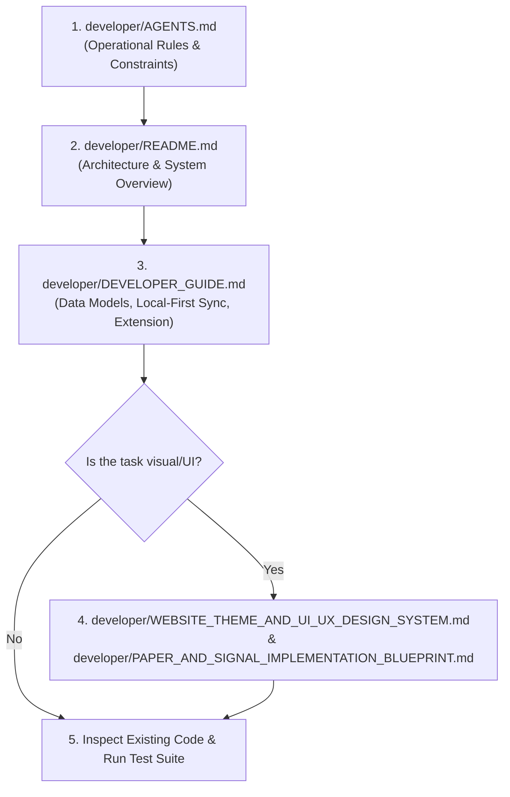

# AI Engineer Command Center — Developer Knowledge Base & Handover Index

Welcome to the permanent developer documentation directory for the **AI Engineer Command Center**.

This directory serves as the centralized, immutable source of truth for the application's architecture, design system, operational rules, implementation history, and future development workflows. Any human engineer, Codex instance, or AI coding agent working in this repository must use this folder to onboard, understand constraints, and maintain complete continuity across sessions without relying on conversational history.

---

## 1. Quick Navigation & Document Index

| Document | Purpose & Scope | When to Read |
| :--- | :--- | :--- |
| **[AGENTS.md](AGENTS.md)** | Standing operational rules, non-negotiable architectural constraints, protected files, design tokens, and verification protocols. | **Read first** before writing or modifying any code. |
| **[REPOSITORY_CLEANUP_AUDIT.md](REPOSITORY_CLEANUP_AUDIT.md)** | Records verified legacy cleanup, retained files, and items that require further evidence before removal. | When considering repository pruning or dependency cleanup. |
| **[DEVELOPER_GUIDE.md](DEVELOPER_GUIDE.md)** | Deep technical manual: full schema models, state shape, codecs, Firestore reconciliation, conflict resolution algorithms, and schema extension checklists. | When touching state, persistence, sync, backend, or adding new features. |
| **[WEBSITE_THEME_AND_UI_UX_DESIGN_SYSTEM.md](WEBSITE_THEME_AND_UI_UX_DESIGN_SYSTEM.md)** | Canonical Paper & Signal design specification: verified OS font stacks, confirmed palette tokens, semantic content-type tinting, and typography scales. | When building, modifying, or refactoring any visual component or view. |
| **[PAPER_AND_SIGNAL_IMPLEMENTATION_BLUEPRINT.md](PAPER_AND_SIGNAL_IMPLEMENTATION_BLUEPRINT.md)** | Comprehensive architectural component blueprint detailing the systematic redesign across all application views and milestone deliverables. | When reviewing component architecture, UX structure, or feature evolution. |
| **[ui_ux_audit_report.md](ui_ux_audit_report.md)** | Comprehensive baseline UI/UX audit report across desktop and mobile viewports with ranked usability defects and responsive standards. | When verifying responsiveness, mobile layout reflow, touch targets, or accessibility. |

---

## 2. Required Reading Order for AI Agents and Developers

To ensure full architectural alignment and avoid introducing regressions, follow this sequence:



1. **Step 1:** Read [developer/AGENTS.md](AGENTS.md) to internalize the protected boundaries, design tokens, and automated check requirements.
2. **Step 2:** Read this document ([developer/README.md](README.md)) to understand application purpose, components, and continuity protocols.
3. **Step 3:** Read [developer/DEVELOPER_GUIDE.md](DEVELOPER_GUIDE.md) to understand the local-first state lifecycle, Firestore rules, and conflict resolution mechanisms.
4. **Step 4 (for UI tasks):** Consult [WEBSITE_THEME_AND_UI_UX_DESIGN_SYSTEM.md](WEBSITE_THEME_AND_UI_UX_DESIGN_SYSTEM.md) and [PAPER_AND_SIGNAL_IMPLEMENTATION_BLUEPRINT.md](PAPER_AND_SIGNAL_IMPLEMENTATION_BLUEPRINT.md) for precise tokens, typography, and layout rules.
5. **Step 5:** Inspect the existing component implementation and verify the test suite (`npm run test`) before proposing changes.

---

## 3. Application Purpose & Major Features

The **AI Engineer Command Center** is a personal learning companion and syllabus tracking platform specifically engineered for mastering the official 20-week DataMites AI Engineer curriculum (`CDM-AIE-BUN-071`) alongside curated high-yield supplements (CodeWithHarry Python Bootcamp, CodeWithHarry Data Science & ML, and SSD archive electives).

### Core Features
1. **Executive Dashboard (`DashboardView.tsx`):**
   - Active week status, pace metrics, competency area progress, study streak tracking, and quick jump into the current week's study room.
2. **My Learning Plan (`LearningPlanView.tsx`):**
   - 20-week chronological curriculum progression, dynamic study schedule generator based on live training hours and self-study capacity, and 7-day schedule matrix.
3. **Official Curriculum (`CurriculumView.tsx`):**
   - Full 20-week DataMites module accordion, official topic mastery tracking, brochure topic codes, and granular subtopic status toggles (`not_started`, `in_progress`, `completed`).
4. **Weekly Study Room (`WeeklyStudyRoomView.tsx`):**
   - Dedicated immersion workspace for the active week: official DataMites lecture notes, multi-tier supplementary guides, curated external resources, active recall questions, and practical code exercises with integrated timer.
5. **Projects & Portfolio (`ProjectsView.tsx`):**
   - Structured tracking for required and elective AI engineering projects (Tier 1 DataMites capstones, Tier 2 Python/ML projects, Tier 3 advanced deployments). Includes GitHub link recording, project status, architecture summaries, and live demo URLs.
6. **Revision & Assessments (`RevisionView.tsx`):**
   - Active recall bank: 46+ interactive 3D flashcards (with Leitner-style mastery states), weekly multiple-choice quizzes with explanations, short-answer conceptual checks with model rubrics, offline coding/debugging exercises, and a persistent Weak Concepts Queue.
7. **Resource Library (`ResourceLibraryView.tsx`):**
   - Curated directory of 348 learning resources categorized by tier (DataMites Core, CodeWithHarry Python/DS, SSD Archive, Documentation, Books). Instant search, tier chips, and week filters.
8. **Learning Journal (`JournalView.tsx`):**
   - Daily structured reflection tool with 7 core fields organized into 3 collapsible sections (*Understanding*, *Code & Bugs*, *Mentor & Next steps*). Full historical log with date metadata.
9. **Progress Analytics (`AnalyticsView.tsx`):**
   - Recharts-powered data visualization: topic completion distribution, weekly study hour breakdown, practice log counts, and quiz attempt trajectory.
10. **System Settings (`SettingsView.tsx`) & Onboarding (`OnboardingModal.tsx`):**
    - Learner profile configuration, weekly study hour target budget, Firebase cloud sync status, automated JSON safety backups, downloadable state export/import, non-destructive initial onboarding modal, and explicit progress reset confirmation.

---

## 4. Technology Stack & Architecture

- **Runtime & Build:** Node.js `>=22.18.0`, Vite 8 (`@vitejs/plugin-react`), TypeScript 7.
- **Frontend Framework:** React 19 (`react`, `react-dom`).
- **Styling & CSS:** Tailwind CSS v4 (`@tailwindcss/vite`, CSS theme variables defined in `src/index.css`).
- **Icons & Motion:** Lucide React (`lucide-react`), Motion (`motion`).
- **Visualization:** Recharts (`recharts` v3) with custom SVG styling tied strictly to Paper & Signal palette tokens.
- **Backend & Cloud:** Firebase Auth (Google Sign-In popup) + Cloud Firestore (default database on the free Spark plan).
- **Hosting:** Vercel (Hobby tier) with client-side SPA routing and custom HTTP security headers (`vercel.json`).
- **Testing:** Node.js native test runner (`node --test "tests/**/*.test.ts"`), zero third-party testing framework dependencies.

---

## 5. Local Persistence & Cross-Device Synchronization

The application is built on a **local-first** paradigm. The UI **never** waits for or depends on network requests.

```text
[ Browser UI / Views ]
         │
         ▼ (Instant optimistic state update)
[ AppStateContext (React State) ]
         │
         ├─────────────────────────────────────────┐
         ▼ (Synchronous write)                     ▼ (Asynchronous queue)
[ localStorage ('aiecc_state_v1') ]        [ Cloud Sync Engine (src/lib/sync/) ]
                                                   │
                                                   ▼ (Coalesced batch write)
                                           [ Cloud Firestore ('users/{uid}/...') ]
```

### Key Synchronization Invariants
1. **Browser Storage (`localStorage`):**
   - Primary state is serialized under the key `aiecc_state_v1`.
   - On application startup, the local cache is validated against `DEFAULT_APP_STATE` to ensure schema integrity.
2. **First-Login Migration:**
   - When a user signs in for the first time with existing local study progress, the client creates a timestamped safety backup in `localStorage` (`aiecc_backup_<uid>_<timestamp>`).
   - The sync engine then reconciles local records with remote documents using non-destructive merge: local records that do not exist remotely are pushed to the cloud, ensuring zero progress loss.
3. **Conflict Resolution ("Newest Wins"):**
   - Updates compare ISO 8601 timestamps (`updatedAt`).
   - The record with the newer timestamp wins in both directions (cloud-to-local and local-to-cloud).
   - Activity logs (capped at 60) and quiz attempts (capped at 200) operate as bounded append-only windows.
4. **Offline Resilience:**
   - Cloud Firestore enables offline persistence (`persistentLocalCache` via IndexedDB).
   - If offline or unauthenticated, the application operates with 100% functionality as a local-only application.
5. **Security Rules (`firestore.rules`):**
   - All user data lives under `users/{uid}/{collection}/{docId}`.
   - Strict document ownership checks (`request.auth.uid == uid`).
   - Server-enforced schema validation on every written field to reject invalid payloads or tampering.

---

## 6. Design System: Paper & Signal

The visual language follows the **Paper & Signal** design identity—an understated, physical-print-inspired aesthetic designed for long, focused study sessions.

### Verified Palette Tokens
```css
--color-paper:      #f7f4ec;  /* Main page background */
--color-surface:    #fdfcf8;  /* Raised surface (cards, dialogs, panels) */
--color-sunken:     #efebdf;  /* Recessed wells (tables, code blocks, summary bars) */
--color-ink:        #17191a;  /* High-contrast primary text and borders */
--color-secondary:  #4a4f4c;  /* Muted captions, metadata, and kickers */
--color-line:       #827d71;  /* Hairline borders (guaranteed >= 3:1 contrast) */
--color-line-soft:  #ddd8cb;  /* Subtle interior card dividers */

/* Semantic Content-Type Pastels (Used ONLY for content category distinction) */
--color-project:    #f4d9c6;  /* Peach = Projects */
--color-research:   #d2e0ea;  /* Blue  = Research & Curriculum */
--color-writing:    #d5e2d0;  /* Sage  = Writing & Journal */

/* Signal Punctuation (Used selectively for primary action and active focus) */
--color-signal:     #d3f03c;  /* Electric lime accent */
```

### Essential Visual Rules
- **Light Mode Only:** Dark mode, theme toggles, and dark hero banners are strictly forbidden.
- **Rectilinear Geometry:** Corners are square (`rounded-none`). No bubbly pill buttons or heavy border radiuses.
- **Hairline Borders:** Cards and panels use crisp 1px solid hairline borders (`border-[var(--color-line)]`).
- **Selective Signal Accent:** Lime (`#d3f03c`) is reserved strictly for primary CTA buttons, active sprint markers, and the high-visibility focus ring (`3px ink outline, 4px offset, 7px lime shadow`). It is **never** used as general card wallpaper.
- **Neutral Statuses:** Status indicators (completed, in-progress, not started) use ink, sunken surfaces, borders, weight, and icons—**never** content-type pastels.
- **Operating System Font Stacks:**
  - Display / Serif: `"Iowan Old Style", "Palatino Linotype", "Book Antiqua", Georgia, serif`
  - Body / Sans: `"Segoe UI", "Helvetica Neue", Arial, sans-serif`
  - Monospace: `"Cascadia Code", Consolas, monospace`
  - Zero external network font requests.

---

## 7. Project Continuity & Development Protocol

Every engineer and AI agent operating in this codebase must adhere strictly to these 10 continuity principles:

1. **Respect Existing Project Decisions:** Do not alter established architectural patterns, naming conventions, or data representations.
2. **Design System Is the Source of Truth:** All visual modifications must conform strictly to [WEBSITE_THEME_AND_UI_UX_DESIGN_SYSTEM.md](WEBSITE_THEME_AND_UI_UX_DESIGN_SYSTEM.md) and [PAPER_AND_SIGNAL_IMPLEMENTATION_BLUEPRINT.md](PAPER_AND_SIGNAL_IMPLEMENTATION_BLUEPRINT.md). Never introduce arbitrary hex codes, gradients, shadows, or rounded geometries.
3. **Implementation Blueprint Provides Context:** Use [PAPER_AND_SIGNAL_IMPLEMENTATION_BLUEPRINT.md](PAPER_AND_SIGNAL_IMPLEMENTATION_BLUEPRINT.md) to understand why component layouts and structures were built the way they are.
4. **UI/UX Audit Report Sets Standards:** Reference [ui_ux_audit_report.md](ui_ux_audit_report.md) for responsive requirements, 44×44px touch-target standards, and mobile reflow invariants.
5. **Standing Agent Rules Are Authoritative:** Follow [developer/AGENTS.md](AGENTS.md) for preflight checklists, verification steps, and reporting rules.
6. **Consult Developer Guide for State Changes:** Any addition of state or schema changes must follow the checklists in [developer/DEVELOPER_GUIDE.md](DEVELOPER_GUIDE.md).
7. **Inspect Existing Code First:** Always read existing components, types, and data files before proposing or writing replacement implementations.
8. **Preserve Working Functionality:** Never remove working features, controls, filters, or sub-tabs simply to make a refactor or redesign easier.
9. **Zero Unnecessary Dependencies or Paid Services:** Do not introduce new npm packages, backend frameworks, paid cloud dependencies (stay strictly on Firebase Spark and Vercel Hobby), or external AI API calls.
10. **Protect User Data & Security Rules:** Preserve all existing user progress in `localStorage`, maintain `firestore.rules` invariants, and ensure backwards compatibility for stored state.

---

## 8. Validation & Build Protocols

Always execute and verify the full automated test suite before committing code:

```bash
# 1. Typecheck TypeScript across all components and tests
npm run typecheck

# 2. Run ESLint code quality checks
npm run lint

# 3. Run the Node.js native unit test suite (53 tests across 8 suites)
npm run test

# 4. Build client bundle for production (includes scripts/check-env.mjs validation)
npm run build
```

### Environment Variable Safeguards
- `scripts/check-env.mjs` validates Firebase configuration during `npm run build`.
- In CI or Vercel environments (`process.env.VERCEL=1`), `npm run build` operates in **strict mode** and will intentionally fail if Firebase variables are missing or placeholders, preventing broken deployments.
- For local builds without Firebase credentials, run:
  ```bash
  ALLOW_LOCAL_ONLY_BUILD=1 npm run build
  ```

---

## 9. Git Branching & Pull Request Workflow

- **Active Development Branch:** Work on `feature/paper-signal-foundation` (or task-specific feature branches branched from it).
- **Protected Branch:** **Never** commit directly to `main`.
- **Commit Format:** Use semantic commit prefixes:
  - `feat(ui): ...` for new features and view implementations.
  - `fix(ui): ...` for bug fixes and audit remediation.
  - `docs: ...` for documentation and architectural records.
  - `chore: ...` for maintenance.
- **Pull Requests:** Open PRs targeting `main` to trigger Vercel Preview deployments. Verify preview builds and ensure zero horizontal overflow (`document.documentElement.scrollWidth <= window.innerWidth`) before merging.
