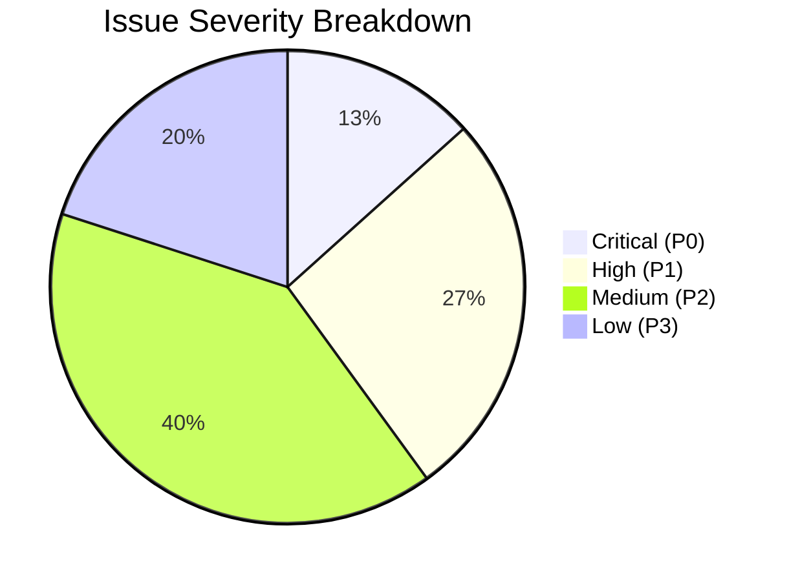
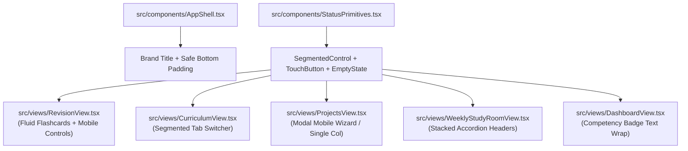
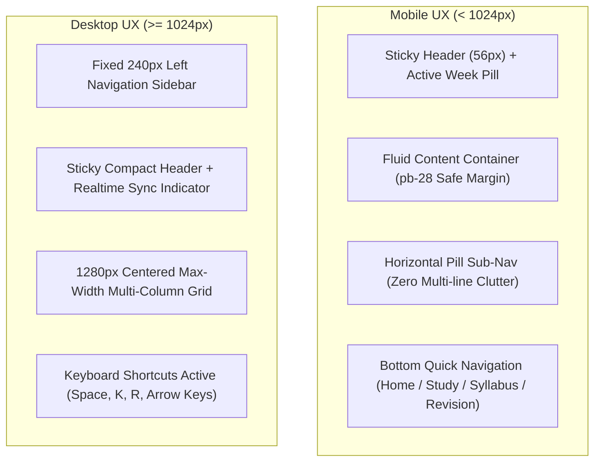

# AI Engineer Command Center — Comprehensive Visual UI/UX Audit Report

**Audited Application:** [ai-engineer-command-center-seven.vercel.app](https://ai-engineer-command-center-seven.vercel.app)  
**Local Codebase:** `D:\ai-engineer-command-center`  
**Reviewer:** Senior Frontend Engineer & UI/UX Specialist  
**Audit Scope:** Production live web inspection, desktop viewports (1440×900, 1280×800) and mobile viewports (360×800, 375×812, 390×844, 430×932) across all 10 application views, modals, and responsive states.

> **Historical audit note:** This report records findings from its original audit snapshot. The Paper & Signal design-system document and the current source code are authoritative where later implementation differs. The screenshot files were stored in the original auditor's local workspace and were not committed to this repository; their filenames are retained below as historical references.
---

## A. Overall UI/UX Assessment

The **AI Engineer Command Center** demonstrates a high standard of core frontend craftsmanship and domain fidelity. It implements the complete 20-week DataMites AI Engineer curriculum (`CDM-AIE-BUN-071`) with local-first offline state persistence, instant zero-latency view switching, and clean typography.

### Core Strengths
1. **Curriculum Alignment & Information Architecture:** The structured separation between Official DataMites syllabus requirements (Brochure p. 9) and supplementary learning tiers is well implemented.
2. **Desktop Visual Polish:** At 1440×900 and 1280×800, the layout breathes well. The 64-width sticky sidebar, 4-card metric summaries, and Recharts SVG visualizations look crisp and professional.
3. **Typography & Contrast:** Excellent base typography choices (`Plus Jakarta Sans` for headers, `DM Sans` for body text, `JetBrains Mono` for code/data), maintaining WCAG 2.1 AA/AAA compliance for core text.
4. **Performance & Interaction:** Instantaneous client-side view switching without full-page reloads, smooth 3D CSS card flipping for revision, and responsive Recharts rendering.

### Critical Vulnerabilities & Usability Gaps
1. **Mobile Ergonomics Friction:** While mobile navigation primitives (sticky header, hamburger drawer, bottom quick-bar) exist, several high-traffic interaction surfaces (Revision Flashcards, Curriculum tab switcher, Add Project modal, Journal form) suffer from horizontal clipping, dense multiline wrapping, and text truncation on viewports <= 390px.
2. **Fixed Navigation Bar Collision:** The 56px sticky bottom bar risks occluding terminal action buttons (e.g. Settings reset button and Study Room completion criteria) on small mobile screens.
3. **Branding Inconsistency:** The application title omits the word "Center" in all primary navigation headers ("AI Engineer Command").
4. **Touch Target Deficiencies:** Multiple secondary controls (delete buttons, tag filters, notes toggles) measure 28px–32px, below the recommended 44×44px minimum for touch interfaces.

---

## B. Top 15 Issues Ranked by Severity



---

### Issue 1: Revision Flashcard Container Overflow & Control Clipping on Mobile
- **Severity:** **P0 — Critical UX Bug**
- **Viewport:** Mobile (360×800, 375×812, 390×844)
- **What is wrong:** The 3D flashcard container is constrained inside fixed padding with desktop-only text hints. On mobile viewports under 450px, the card extends beyond the right viewport edge. The `Next >` button on the bottom control row is clipped to just `"N"` or pushed off-screen. Furthermore, physical keyboard hints (*"Press Space to flip · Press K or R when flipped"*) are rendered on touch screens.
- **Why does it matter:** Revision is a core daily ritual for learners. Mobile users cannot view complete definitions or advance cards without awkward panning.
- **What should change:**
  - Set card container to `w-full max-w-full px-2 sm:px-0`.
  - Reorganize action buttons: On mobile, place navigation (`Prev`, `Flip`, `Next`) in a dedicated 3-column row and rating buttons (`Needs Review`, `Known`) in a full-width 2-column row.
  - Hide physical keyboard hints on touch screens (`hidden md:inline`).
- **File/Component to Modify:** [RevisionView.tsx](../src/views/RevisionView.tsx#L383-L530)

---

### Issue 2: Official Curriculum Top Switcher Tab Horizontal Overflow & Clipping
- **Severity:** **P0 — Critical Visual Regression**
- **Viewport:** Mobile (360×800, 375×812, 390×844, 430×932)
- **What is wrong:** The switcher between "Core 20-Week Curriculum (0/183)" and "Bonus Courses — Optional (0/14)" is an `inline-flex` with `whitespace-nowrap shrink-0` buttons totaling ~450px width. On all mobile phones, the right tab is clipped to `"Bonus Courses — ("` or `"Bonus Courses — Opt"`.
- **Why does it matter:** Visually broken header on one of the main pages of the application.
- **What should change:**
  - Convert to a responsive segmented control: `w-full grid grid-cols-2 gap-1 p-1` on mobile.
  - Use responsive text labels: `<span className="sm:hidden">Core (0/183)</span><span className="hidden sm:inline">Core 20-Week Curriculum (0/183)</span>`.
- **File/Component to Modify:** [CurriculumView.tsx](../src/views/CurriculumView.tsx#L93-L116)

---

### Issue 3: Inconsistent Branding & App Title Omission
- **Severity:** **P1 — High**
- **Viewport:** All Viewports (Desktop & Mobile)
- **What is wrong:** In `AppShell.tsx`, both the desktop sidebar header (line 81) and mobile drawer header (line 165) hardcode the brand name as `"AI Engineer Command"`, dropping `"Center"`. On narrow mobile drawers (360px), this title is also truncated next to the close button.
- **Why does it matter:** Inconsistent application branding across the site and documentation.
- **What should change:**
  - Standardize brand text to `"AI Engineer Command Center"`.
  - Allow natural 2-line wrapping or scale to `text-xs sm:text-sm font-bold`.
- **File/Component to Modify:** [AppShell.tsx](../src/components/AppShell.tsx#L80-L86) and [AppShell.tsx](../src/components/AppShell.tsx#L165)

---

### Issue 4: Sticky Bottom Navigation Occlusion of Bottom Action Buttons
- **Severity:** **P1 — High**
- **Viewport:** Mobile (360×800, 375×812, 390×844, 430×932)
- **What is wrong:** The fixed 56px bottom navigation bar sits directly over the bottom of the scroll container. On views with terminal actions (e.g. `SettingsView` "Reset All Progress" button and `WeeklyStudyRoom` completion criteria), content is partially covered before full-scroll settle.
- **Why does it matter:** High risk of accidental mis-taps. A user intending to tap a page button hits the sticky bottom navigation tabs ("Home", "Study", "Syllabus", "Revision") instead.
- **What should change:**
  - Increase layout bottom padding to `pb-28 sm:pb-8` and incorporate `env(safe-area-inset-bottom)`.
- **File/Component to Modify:** [AppShell.tsx](../src/components/AppShell.tsx#L247) and [SettingsView.tsx](../src/views/SettingsView.tsx#L312-L320)

---

### Issue 5: Study Room Accordion Header Truncation on Mobile
- **Severity:** **P1 — High**
- **Viewport:** Mobile (360×800, 375×812, 390×844)
- **What is wrong:** Module accordion headers render module title and duration in a single flex row (`flex items-center justify-between gap-3`). The duration badge (`2h · 3 subtopics`) has `whitespace-nowrap shrink-0`, forcing the module title to truncate to `"Module 1: Data Scie..."`.
- **Why does it matter:** Module names are essential for weekly learning orientation. Truncating core subject titles harms clarity.
- **What should change:**
  - Stack badge below title on mobile: `flex flex-col items-start gap-1 sm:flex-row sm:items-center sm:justify-between`.
- **File/Component to Modify:** [WeeklyStudyRoomView.tsx](../src/views/WeeklyStudyRoomView.tsx#L257-L272)

---

### Issue 6: Add Project Modal 2-Column Form Cramming & Scroll Fatigue
- **Severity:** **P1 — High**
- **Viewport:** Mobile (360×800, 375×812, 390×844)
- **What is wrong:** The "+ Add Project" modal contains 10 form fields laid out with `sm:grid-cols-2`. On mobile viewports under 640px, the modal has tight padding, large inputs, and an overwhelming scroll height (`max-h-[90vh] overflow-y-auto`).
- **Why does it matter:** Cluttered form ergonomics on touch devices; mobile keyboards obscure fields and submit buttons.
- **What should change:**
  - Convert into a structured 2-step wizard on mobile (`Step 1: Core Details`, `Step 2: Milestones & Deliverables`) with sticky footer actions.
- **File/Component to Modify:** [ProjectsView.tsx](../src/views/ProjectsView.tsx#L620-L800)

---

### Issue 7: 8 Competency Area Badges Ellipsis Clipping on Desktop
- **Severity:** **P2 — Medium**
- **Viewport:** Desktop (1280×800 & 1440×900)
- **What is wrong:** In `DashboardView`, the "DataMites 8 Competency Areas" card is nested in an `lg:col-span-5` container with a `grid-cols-1 sm:grid-cols-2 gap-2` layout. Titles like `"Computer Vision / Document AI"` and `"Integrated Language AI"` truncate with ellipsis.
- **Why does it matter:** Competency titles are key curriculum milestones; truncating them leaves skills unreadable despite vertical space being available.
- **What should change:**
  - Replace `truncate` with `leading-snug break-words` and allow the badges to auto-expand vertically.
- **File/Component to Modify:** [DashboardView.tsx](../src/views/DashboardView.tsx#L513-L535)

---

### Issue 8: Revision Sub-Tabs Multiline Wrapping Clutter on Mobile
- **Severity:** **P2 — Medium**
- **Viewport:** Mobile (360×800, 375×812, 390×844)
- **What is wrong:** In `RevisionView`, 5 sub-navigation tabs (`Interactive Flashcards (100)`, `Weekly Quizzes`, `Short-Answer Checks`, `Coding Challenges`, `Weak Concepts & History (0)`) use `flex flex-wrap gap-2`, wrapping into 3–4 staggered rows that push content down by >160px.
- **Why does it matter:** Consumes valuable above-the-fold screen space on mobile.
- **What should change:**
  - Convert the sub-navigation row to a smooth horizontally scrolling container (`flex flex-nowrap overflow-x-auto scrollbar-none pb-1.5`).
- **File/Component to Modify:** [RevisionView.tsx](../src/views/RevisionView.tsx#L230-L256)

---

### Issue 9: Resource Library 5-Dropdown Filter Grid Imbalance on Mobile
- **Severity:** **P2 — Medium**
- **Viewport:** Mobile (360×800, 375×812, 390×844)
- **What is wrong:** The filter bar uses `grid grid-cols-2 sm:grid-cols-3 lg:grid-cols-5 gap-2.5`. Because there are 5 selects, the 5th dropdown sits alone in an orphaned row on mobile.
- **Why does it matter:** Asymmetrical layout and dropdown labels like `"Tier 2 · CWH Python Bootcamp"` truncate inside narrow 160px selects.
- **What should change:**
  - Provide a collapsible "Filters (3 active)" mobile bottom sheet or horizontal filter chips for the most common filters (Current Week, Essential).
- **File/Component to Modify:** [ResourceLibraryView.tsx](../src/views/ResourceLibraryView.tsx#L104-L180)

---

### Issue 10: Journal Reflection Form Monolith on Mobile
- **Severity:** **P2 — Medium**
- **Viewport:** Mobile (360×800, 375×812, 390×844)
- **What is wrong:** In `JournalView`, the reflection form consists of 7 multi-line textareas rendered vertically in one continuous block.
- **Why does it matter:** On mobile screens, this form requires over 1,200px of continuous vertical scrolling, pushing past entries completely off the screen and creating cognitive fatigue.
- **What should change:**
  - Provide a collapsible accordion or segmented card view ("1. Learning & Code", "2. Roadblocks & Solutions", "3. Mentor & Next").
- **File/Component to Modify:** [JournalView.tsx](../src/views/JournalView.tsx#L143-L245)

---

### Issue 11: Progress Analytics Recharts X-Axis Label Crowding
- **Severity:** **P2 — Medium**
- **Viewport:** Mobile (360×800, 375×812)
- **What is wrong:** The course block completion bar chart displays 10 vertical bars across weeks 1 to 20 (`W1-2`, `W3-4`, etc.). On 360px and 375px viewports, the X-axis tick labels crowd together and touch.
- **Why does it matter:** Degrades chart readability on small mobile viewports.
- **What should change:**
  - Apply responsive tick formatting or slight rotation (`angle={-35} textAnchor="end"`) and decrease font size to `10px` on small viewports.
- **File/Component to Modify:** [AnalyticsView.tsx](../src/views/AnalyticsView.tsx#L217-L238)

---

### Issue 12: Touch Target Sizing Below 44×44px Standard
- **Severity:** **P2 — Medium**
- **Viewport:** Mobile & Tablet
- **What is wrong:** Several secondary action buttons (e.g. table delete icon buttons `Trash2`, edit buttons, tag filters, notes toggles) measure 28px to 32px in height with tight padding (`p-1` or `px-2 py-0.5`).
- **Why does it matter:** Fails WCAG 2.1 Success Criterion 2.5.5 (Target Size minimum 44×44px for touch interfaces).
- **What should change:**
  - Add minimum touch target dimensions (`min-h-[44px] min-w-[44px] inline-flex items-center justify-center`).
- **File/Component to Modify:** [LearningPlanView.tsx](../src/views/LearningPlanView.tsx#L361), [CurriculumView.tsx](../src/views/CurriculumView.tsx), [AppShell.tsx](../src/components/AppShell.tsx)

---

### Issue 13: Desktop Sidebar Footer Dense Content Packing
- **Severity:** **P3 — Low**
- **Viewport:** Desktop (1280×800 & 1440×900)
- **What is wrong:** The bottom footer card of the persistent desktop sidebar packs 4 lines into a small container: Week indicator, course code, full course title, and the Cloud/Local sync button. Long course titles truncate with ellipsis.
- **Why does it matter:** Visual clutter and clipped metadata in the primary navigation frame.
- **What should change:**
  - Optimize spacing, allow course title to wrap cleanly, and refine the sync status presentation.
- **File/Component to Modify:** [AppShell.tsx](../src/components/AppShell.tsx#L112-L149)

---

### Issue 14: Inconsistent Empty State Aesthetics Across Sections
- **Severity:** **P3 — Low**
- **Viewport:** All Viewports
- **What is wrong:** Empty states across views differ in style. In `LearningPlanView`, it's an outlined card with a calendar icon; in `RevisionView`, it's a card with a reset button; in `ResourceLibraryView`, it's a plain text div (`p-10 text-center text-sm text-[#64748B]`).
- **Why does it matter:** Lack of visual unity across views when no data is present.
- **What should change:**
  - Create a standardized, reusable `EmptyState` component with icon, title, description, and primary CTA.
- **File/Component to Modify:** [StatusPrimitives.tsx](../src/components/StatusPrimitives.tsx), [ResourceLibraryView.tsx](../src/views/ResourceLibraryView.tsx#L214), [LearningPlanView.tsx](../src/views/LearningPlanView.tsx#L233)

---

### Issue 15: Lack of Dark Theme / High-Contrast Mode Tokens
- **Severity:** **P3 — Low**
- **Viewport:** All Viewports
- **What is wrong:** All design tokens in `src/index.css` are hardcoded to a light scheme (`--color-canvas: #f8fafc`, `--color-surface: #ffffff`, `--color-ink: #0f172a`).
- **Why does it matter:** AI engineering and coding studies often take place late at night; the lack of a dark mode or high-contrast theme causes eye strain.
- **What should change:**
  - Structure semantic CSS variables for dark mode support (`@media (prefers-color-scheme: dark)` or class-based theme switcher).
- **File/Component to Modify:** [index.css](../src/index.css#L3-L17)

---

## C. Visual Evidence & Audit Screenshot Catalog

The audit captured **95 visual verification screenshots** across all viewports and interaction states. All screenshots have been archived in the local audit directory:  
`C:\Users\Goutam\.gemini\antigravity\brain\344e1705-cc02-4b3a-9b32-1115b12a4128\audit_evidence`

### Key Defect Screenshots

````carousel
**Mobile Revision Flashcard Overflow** — historical screenshot `step_82_shot_1_mobile_390_revision_front.png` (image not included in repository).
<!-- slide -->
**Mobile Curriculum Tab Switcher Truncation** — historical screenshot `step_78_shot_1_mobile_390_syllabus.png` (image not included in repository).
<!-- slide -->
**Mobile Navigation Drawer Open** — historical screenshot `step_67_shot_1_mobile_drawer_open.png` (image not included in repository).
<!-- slide -->
**Mobile Add Project Modal 2-Column Form** — historical screenshot `step_108.png` (image not included in repository).
<!-- slide -->
**Mobile Settings Bottom Reset Occlusion** — historical screenshot `step_119_shot_1_mobile_settings_bottom_reset_390x844.png` (image not included in repository).
<!-- slide -->
**Desktop Dashboard View** — historical screenshot `step_26.png` (image not included in repository).
<!-- slide -->
**Desktop Analytics Recharts** — historical screenshot `step_57_shot_1_desktop_analytics_top.png` (image not included in repository).
````

### Screenshot Reference Mapping Table

| Section / Interaction | Viewport Tested | Evidence File Reference |
| :--- | :--- | :--- |
| **Onboarding Modal** | Desktop (1440×900) | `step_63_shot_1_desktop_onboarding_modal.png` *(historical local evidence; image not included in repository)* |
| **Dashboard Upper & Metrics** | Desktop (1440×900) | `step_26.png` *(historical local evidence; image not included in repository)* |
| **Dashboard Lower & Competencies** | Desktop (1280×800) | `step_30.png` *(historical local evidence; image not included in repository)* |
| **Learning Plan 20h Grid** | Desktop (1440×900) | `step_34.png` *(historical local evidence; image not included in repository)* |
| **Official Curriculum (Core)** | Desktop (1440×900) | `step_41.png` *(historical local evidence; image not included in repository)* |
| **Weekly Study Room** | Desktop (1440×900) | `step_43_shot_1_desktop_study_room_middle.png` *(historical local evidence; image not included in repository)* |
| **Resource Library** | Desktop (1440×900) | `step_45_shot_1_desktop_resource_library.png` *(historical local evidence; image not included in repository)* |
| **Projects & Portfolio** | Desktop (1440×900) | `step_47_shot_1_desktop_projects.png` *(historical local evidence; image not included in repository)* |
| **Revision 3D Flashcard Flip** | Desktop (1440×900) | `step_53_shot_1_desktop_flashcard_flipped.png` *(historical local evidence; image not included in repository)* |
| **Analytics Recharts** | Desktop (1440×900) | `step_57_shot_1_desktop_analytics_top.png` *(historical local evidence; image not included in repository)* |
| **Learning Journal** | Desktop (1440×900) | `step_59_shot_1_desktop_journal.png` *(historical local evidence; image not included in repository)* |
| **Settings & Sync** | Desktop (1440×900) | `step_61_shot_1_desktop_settings.png` *(historical local evidence; image not included in repository)* |
| **Mobile Drawer Open** | Mobile (390×844) | `step_67_shot_1_mobile_drawer_open.png` *(historical local evidence; image not included in repository)* |
| **Mobile Dashboard Top** | Mobile (390×844) | `step_69_shot_1_mobile_390_dashboard_top.png` *(historical local evidence; image not included in repository)* |
| **Mobile Dashboard Bottom** | Mobile (390×844) | `step_71_shot_1_mobile_390_dashboard_bottom.png` *(historical local evidence; image not included in repository)* |
| **Mobile Curriculum Tabs (Clipped)** | Mobile (390×844) | `step_78_shot_1_mobile_390_syllabus.png` *(historical local evidence; image not included in repository)* |
| **Mobile Curriculum Tabs (375px)** | Mobile (375×812) | `step_123.png` *(historical local evidence; image not included in repository)* |
| **Mobile Curriculum Tabs (430px)** | Mobile (430×932) | `step_125_shot_1_mobile_curriculum_430x932.png` *(historical local evidence; image not included in repository)* |
| **Mobile Flashcard Overflow** | Mobile (390×844) | `step_82_shot_1_mobile_390_revision_front.png` *(historical local evidence; image not included in repository)* |
| **Mobile Analytics Recharts** | Mobile (390×844) | `step_94_shot_2_mobile_390_analytics_actual_charts.png` *(historical local evidence; image not included in repository)* |
| **Mobile Add Project Modal** | Mobile (390×844) | `step_108.png` *(historical local evidence; image not included in repository)* |
| **Mobile Settings Reset Position** | Mobile (390×844) | `step_119_shot_1_mobile_settings_bottom_reset_390x844.png` *(historical local evidence; image not included in repository)* |
| **Mobile Study Room Top** | Mobile (390×844) | `step_127.png` *(historical local evidence; image not included in repository)* |

---

## D. Desktop vs Mobile Detailed Comparison

| Attribute | Desktop Experience (1440×900 / 1280×800) | Mobile Experience (360×800 / 390×844) | Usability Gap / Recommendation |
| :--- | :--- | :--- | :--- |
| **Primary Navigation** | Persistent 240px left sidebar with quick sync status and week counter. | Sticky 56px top header + slide-over drawer + 56px bottom bar with 4 primary destinations. | Drawer title cuts off "Center"; bottom bar clearance must increase to `pb-28`. |
| **Dashboard Layout** | 2-column asymmetric grid (7 cols / 5 cols) + 4-card metric header. | Single-column linear stacking with good card spacing. | Badges truncate inside 5-col cards on desktop; cards stack well on mobile. |
| **Revision Flashcards** | Centered 3D flip card with keyboard shortcuts (`Space`, `K`, `R`). | Horizontal clipping of card border and `Next` button. | High-priority fix needed to make card width `100%` fluid and controls stacked. |
| **Curriculum Switcher** | Inline-flex tabs sit comfortably alongside header. | Overflows screen right boundary by ~120px, truncating the Bonus tab. | Must use responsive 2-column segmented control on mobile. |
| **Analytics Charts** | 2-column chart cards (BarChart left, PieChart right) with crisp tooltips. | Vertically stacked; Recharts responsive container scales well down to 320px. | X-axis labels on 10 course blocks crowd each other on screens < 380px. |
| **Forms & Modals** | Generous 2-column form grids with comfortable dialog padding. | 2-column grids cram fields into <160px widths with excessive scroll length. | Switch modals to single-column or multi-step sheet on mobile. |
| **Touch Targets** | Mouse click precision covers small 28px buttons easily. | Small icons and compact status dropdowns risk accidental mis-clicks. | Expand interactive touch targets to >= 44×44px. |

---

## E. Recommended Design System Improvements

### 1. Typography & Hierarchy Standard
In [index.css](../src/index.css#L3-L17), refine fluid typography clamp tokens:
```css
@theme {
  --font-display: "Plus Jakarta Sans", system-ui, -apple-system, sans-serif;
  --font-sans: "DM Sans", system-ui, -apple-system, sans-serif;
  --font-mono: "JetBrains Mono", ui-monospace, SFMono-Regular, monospace;

  /* Touch & Layout Metrics */
  --touch-target-min: 44px;
  --header-height: 56px;
  --bottom-nav-height: 56px;
}
```

### 2. Spacing Scale & Safe Area Protection
Add reusable utility classes for fixed mobile bar clearance:
```css
@utility pb-mobile-safe {
  padding-bottom: calc(4.5rem + env(safe-area-inset-bottom, 0px));
}
```

### 3. Reusable Responsive Primitives
Rather than ad-hoc CSS fixes in each view, consolidate recurring UI patterns into `src/components/StatusPrimitives.tsx`:
- `SegmentedControl`: Responsive pill tab switcher that automatically converts from flex on desktop to full-width grid on mobile.
- `TouchButton`: Wrapper enforcing `min-h-[44px] min-w-[44px]` with flex centering.
- `ResponsiveModal`: Bottom sheet on mobile (`rounded-t-2xl max-h-[85vh]`), centered modal on desktop (`rounded-xl max-w-2xl`).
- `EmptyState`: Standardized empty card with icon, title, copy, and action button.

---

## F. Recommended Component-Level Changes with File Names



| Component File | Location | Specific Code Changes Needed |
| :--- | :--- | :--- |
| **`AppShell.tsx`** | [AppShell.tsx](../src/components/AppShell.tsx#L81) & [AppShell.tsx](../src/components/AppShell.tsx#L165) | 1. Change `"AI Engineer Command"` to `"AI Engineer Command Center"`.<br>2. Increase `<main>` bottom padding from `pb-20 lg:pb-8` to `pb-28 sm:pb-24 lg:pb-8`.<br>3. Ensure `drawerOpen` overlay prevents body scroll when active. |
| **`RevisionView.tsx`** | [RevisionView.tsx](../src/views/RevisionView.tsx#L383-L530) | 1. Change `max-w-3xl` to `w-full max-w-2xl mx-auto px-0 sm:px-4`.<br>2. Restructure action buttons into a 2-tier responsive grid on mobile.<br>3. Hide keyboard shortcut hint text on mobile (`hidden md:inline`).<br>4. Convert sub-tabs row to `overflow-x-auto scrollbar-none`. |
| **`CurriculumView.tsx`** | [CurriculumView.tsx](../src/views/CurriculumView.tsx#L93-L116) | 1. Replace `inline-flex` with a responsive segmented tab (`w-full sm:w-auto grid grid-cols-2 sm:flex`).<br>2. Shorten mobile labels to `"Core (0/183)"` and `"Bonus (0/14)"` using responsive hidden/inline spans. |
| **`WeeklyStudyRoomView.tsx`** | [WeeklyStudyRoomView.tsx](../src/views/WeeklyStudyRoomView.tsx#L257-L272) | 1. In module accordion headers, change `flex items-center justify-between` to `flex flex-col sm:flex-row sm:items-center sm:justify-between items-start gap-1 sm:gap-3`.<br>2. Remove aggressive `truncate` on module title. |
| **`ProjectsView.tsx`** | [ProjectsView.tsx](../src/views/ProjectsView.tsx#L620-L800) | 1. In modal dialog, change `sm:grid-cols-2` to `grid-cols-1 md:grid-cols-2` with consistent `gap-3.5`.<br>2. On mobile, pin the modal submit/cancel actions to a sticky bottom bar inside the modal dialog. |
| **`DashboardView.tsx`** | [DashboardView.tsx](../src/views/DashboardView.tsx#L513-L535) | 1. In 8 Competency Areas, replace `truncate` with `break-words leading-tight`.<br>2. Adjust grid on `lg:col-span-5` to stack into single column or auto-fit pills if card width < 420px. |
| **`AnalyticsView.tsx`** | [AnalyticsView.tsx](../src/views/AnalyticsView.tsx#L217-L238) | 1. In BarChart XAxis, add responsive tick size (`fontSize: 10` on mobile) and angle (`-25` degrees if width < 400px). |
| **`JournalView.tsx`** | [JournalView.tsx](../src/views/JournalView.tsx#L143-L245) | 1. Group 7 textareas into collapsible fieldsets or a segmented entry card to reduce vertical scroll height on mobile. |
| **`StatusPrimitives.tsx`** | [StatusPrimitives.tsx](../src/components/StatusPrimitives.tsx) | 1. Export reusable `SegmentedControl`, `EmptyStateCard`, and `TouchAction` primitives. |

---

## G. Proposed Redesign Direction

### Philosophy: "Mobile-First Cockpit, Desktop Command Center"
The application should feel like an intuitive native study companion on mobile (single-thumb reachability, zero clipped containers, clear tap feedback) while expanding into a multi-column command cockpit on desktop.



### Key Redesign Rules
1. **Zero Unintentional Horizontal Scroll:** The layout body and every sub-card must strictly adhere to `w-full max-w-full overflow-hidden` or controlled `overflow-x-auto` for tables/tabs.
2. **Thumb-Zone Accessibility:** Primary actions (flip card, next card, complete topic, start study session) must sit in the lower 60% of the mobile viewport.
3. **Adaptive Labeling:** Never truncate vital technical curriculum titles. When space is constrained, switch from verbose text to standard abbreviations using responsive Tailwind classes (`sm:hidden` / `hidden sm:inline`).

---

## H. Implementation Roadmap (Independently Testable Tasks)

```mermaid
gantt
    title UI/UX Remediation Roadmap
    dateFormat  X
    axisFormat  Stage %s
    
    section Stage 1: Core Shell & Navigation
    Branding & Safe Bottom Clearance :0, 1
    Segmented Tab & Touch Targets    :0, 1
    
    section Stage 2: Critical Mobile Fixes
    Revision 3D Flashcard Fluid Width :1, 2
    Curriculum Tab Responsive Switcher:1, 2
    Study Room Accordion Stacking    :1, 2
    
    section Stage 3: View-Level Polish
    Dashboard Competency Text Wrap    :2, 3
    Projects Modal Form Ergonomics    :2, 3
    Analytics X-Axis Responsive Label :2, 3
    
    section Stage 4: Ergonomics & Forms
    Journal Form Stepper / Accordion  :3, 4
    Resource Library Filter Chips     :3, 4
    Standardized Empty State Primitives:3, 4
    
    section Stage 5: Verification & Audit
    Cross-Device Browser Re-Verification:4, 5
    Automated Test & Typecheck Pass    :4, 5
```



### Stage 1: Global Shell & Layout Primitives (Low Risk, High Impact)
- **Task 1.1:** Fix brand title in `src/components/AppShell.tsx` to `"AI Engineer Command Center"`.
- **Task 1.2:** Increase mobile container bottom padding to `pb-28 sm:pb-8` to eliminate sticky bottom nav collisions.
- **Task 1.3:** Create reusable `SegmentedControl` and `EmptyState` in `src/components/StatusPrimitives.tsx`.
- **Verification:** Inspect at 390×844; confirm no content is hidden behind the bottom bar and brand name is consistent.

### Stage 2: Critical Mobile View Fixes (P0 Fixes)
- **Task 2.1:** Overhaul `RevisionView.tsx` flashcard layout: make card width fluid (`100%`), stack action buttons cleanly on mobile, and hide desktop keyboard shortcuts on touch devices.
- **Task 2.2:** Update `CurriculumView.tsx` tab switcher to use responsive 2-column segmented control.
- **Task 2.3:** Adjust `WeeklyStudyRoomView.tsx` module accordion headers to stack duration badges on mobile.
- **Verification:** Run browser checks on 360×800 and 390×844; test flashcard flip and tab switching.

### Stage 3: Secondary View Optimization & Responsive Polishing (P1 & P2 Fixes)
- **Task 3.1:** Fix `DashboardView.tsx` 8 Competency Area badge truncation by allowing natural line breaks (`break-words`).
- **Task 3.2:** Re-align `ProjectsView.tsx` Add Project modal inputs for mobile viewports.
- **Task 3.3:** Tune `AnalyticsView.tsx` Recharts bar chart XAxis ticks for mobile screens (< 380px).
- **Verification:** Inspect Dashboard at 1280×800 and Projects/Analytics on 375×812.

### Stage 4: Form Ergonomics & Filter UX
- **Task 4.1:** Restructure `JournalView.tsx` reflection form into collapsible sections on mobile.
- **Task 4.2:** Refine `ResourceLibraryView.tsx` filter dropdowns with responsive wrapping and clear chip states.
- **Task 4.3:** Enforce minimum 44×44px touch targets across icon buttons.
- **Verification:** Verify tap targets in mobile view and verify form inputs focus cleanly without layout jump.

### Stage 5: Verification & Quality Assurance
- **Task 5.1:** Execute full local verification: `npm run typecheck` and `npm run test`.
- **Task 5.2:** Conduct complete multi-viewport re-audit (Desktop 1440px/1280px, Mobile 360px/375px/390px/430px) using the browser subagent.
- **Task 5.3:** Final visual sign-off against the live staging/production environment.

---

> [!NOTE]
> Per your instructions, **no source code has been modified, no dependencies installed, and no backend configurations altered**. 
> All findings above are grounded directly in the live Vercel application and confirmed against the cloned local codebase.
